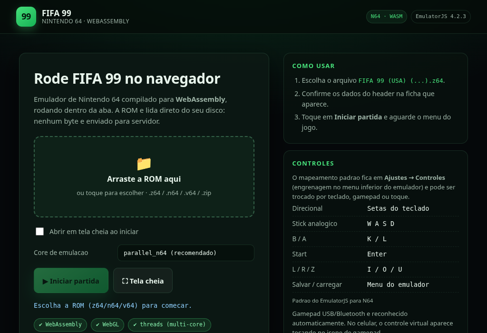

# FIFA 99 (Nintendo 64) no navegador via WebAssembly

Player completo, autossuficiente e testado para rodar **FIFA 99 (N64)** dentro
da aba, com o núcleo de emulação compilado para **WebAssembly**.



---

## 1. O que este projeto é (e o que ele não é)

**É:** um runtime de emulação N64 em WASM (`EmulatorJS 4.2.3` + cores
libretro `parallel_n64` e `mupen64plus_next`), vendorizado dentro do projeto,
mais uma interface própria em pt-BR que valida a ROM, injeta um *Controller Pak*,
salva print, alterna core/threads e roda 100% no cliente.

**Não é:** uma recompilação do jogo. FIFA 99 é software fechado da EA Sports;
não existe código-fonte público para "portar". O caminho tecnicamente correto —
e o que este projeto faz — é emular o hardware original (MIPS R4300i + RCP)
em WebAssembly, que é exatamente o mesmo tipo de "port WASM" usado por
RetroArch, EmulatorJS e afins.

> A ROM **não** está incluída. Veja a seção 3.

---

## 2. Status de validação

Testado de ponta a ponta em Chromium headless (SwiftShader, sem GPU real),
servindo o projeto pelo `server.js`:

| Item | Resultado |
|---|---|
| Headers COOP/COEP → `crossOriginIsolated` | OK |
| `SharedArrayBuffer` disponível | OK (modo multi-thread) |
| Validação do header da ROM (`z64`, nome interno `FIFA 99`, cart `9F`, região `E`) | OK |
| Boot do core `parallel_n64` | OK |
| Emulação contínua | 400 → 1000+ frames sem travar |
| Vídeo (intro EA Sports, tela legal, jogo) | OK |
| Entrada de teclado (START atravessando as telas) | OK |
| *Controller Pak* injetado (sem o prompt "No Controller Pak found") | OK |
| `mupen64plus_next` neste jogo | **trap** `RuntimeError: memory access out of bounds` |

Por causa da última linha, o core padrão deste projeto é o **`parallel_n64`**.
O `mupen64plus_next` continua selecionável (é o padrão do EmulatorJS e funciona
na maioria dos outros jogos N64).

---

## 3. Rodando

Pré-requisito: **Node.js 18+** (nenhuma dependência para instalar).

```bash
npm start
# ou: node server.js
# outra porta: PORT=3000 node server.js
```

Abra `http://localhost:8080`. O servidor imprime também o IP da rede local
para você abrir no celular.

### Por que não serve `python -m http.server` / `npx serve`?

O modo multi-thread do core depende de `SharedArrayBuffer`, que o navegador só
habilita com a página *cross-origin isolated*. Isso exige dois headers que
servidores estáticos genéricos não enviam:

```
Cross-Origin-Opener-Policy: same-origin
Cross-Origin-Embedder-Policy: require-corp
```

O `server.js` já envia ambos (e `Cross-Origin-Resource-Policy: cross-origin`).
Sem eles o app **ainda funciona**, mas cai para o core single-thread
(`?threads=0`) — mais lento e com quedas de quadro.

---

## 4. Colocando a ROM

Duas formas:

1. **Automática** — copie sua ROM para `roms/` com um destes nomes:
   `fifa99.z64`, `FIFA 99 (USA) (En,Fr,De,Es,It,Nl,Pt,Sv).z64`,
   `fifa99.n64`, `fifa99.v64`, `fifa99.zip`. Ao abrir a página, o app valida o
   header e já inicia o jogo.
2. **Manual** — arraste o arquivo para a área pontilhada (ou toque nela e
   escolha o arquivo). A ROM é lida direto do disco via `File` API: **nenhum
   byte é enviado para servidor**, sem upload.

A pasta `roms/` está no `.gitignore`: conteúdo de jogo nunca vai para o repo.

---

## 5. Controles (padrão do EmulatorJS, jogador 1)

| Botão N64 | Tecla |
|---|---|
| A | `X` |
| B | `S` |
| Direcional (D-Pad) | setas |
| Stick analógico | `H` / `F` (eixo X) · `G` / `T` (eixo Y) |
| L / R / Z | `Q` / `E` / `Tab` |
| Botões C | `L` / `J` / `K` / `I` |
| START | `Enter` |
| Avançar / câmera lenta / rewind | `1` / `2` / `3` |

Tudo remapeável em **Ajustes → Controles** (engrenagem no menu inferior do
emulador). Gamepad USB/Bluetooth entra automaticamente; no celular existe
gamepad virtual.

Mapeamento conferido em runtime (`EJS_emulator.defaultControllers`), não é chute.

---

## 6. Opções por URL

| Parâmetro | Efeito |
|---|---|
| `?core=parallel_n64` | força o core padrão (recomendado) |
| `?core=mupen64plus_next` | usa o core alternativo |
| `?threads=1` | força multi-thread (exige `SharedArrayBuffer`) |
| `?threads=0` | força single-thread (máquina fraca / sem COOP+COEP) |

Exemplo: `http://localhost:8080/?core=mupen64plus_next&threads=0`

A escolha de core também está na UI (select "Core de emulação").
Os cores ficam em `vendor/emulatorjs/data/cores/`, em 4 variantes cada
(`-thread`, `-legacy`, `-thread-legacy`), então qualquer combinação resolve
sem download externo.

---

## 7. Salvamento

Dois níveis, ambos funcionando:

1. **Save do próprio jogo** — o app injeta
   `parallel-n64-pak1 = memory` via `EJS_defaultOptions`, então o FIFA 99
   encontra o *Controller Pak* e grava opções/temporada (sem o
   "No Controller Pak found – data cannot be saved").
2. **Save state do emulador** — menu inferior → *Save State* / *Load State*.
   Instantâneo e independente do save interno.

---

## 8. Deploy

O projeto é 100% estático (`index.html` + `js/` + `css/` + `vendor/`).

| Host | Como |
|---|---|
| **Netlify** | arraste a pasta; `netlify.toml` já traz COOP/COEP |
| **Vercel** | `vercel.json` com os mesmos headers |
| **Cloudflare Pages** | `_headers` na raiz com COOP/COEP |
| **GitHub Pages** | funciona, **mas não permite headers** → sem threads; use `?threads=0` |

Sem os headers de isolamento o jogo roda em single-thread. Com eles, o core
multi-thread é escolhido automaticamente.

---

## 9. Solução de problemas

**`RuntimeError: memory access out of bounds` / tela preta com o jogo travado**
→ é o bug conhecido do `mupen64plus_next` neste jogo. Selecione
`parallel_n64` (padrão) ou use `?core=parallel_n64`.

**Aviso "SharedArrayBuffer indisponível" / chip `single-thread`**
→ faltam os headers COOP/COEP. Use o `server.js` ou configure-os no host.

**Tela preta no primeiro segundo**
→ o core está descomprimindo (~1,5 MB na primeira visita) e o IPL do N64
bootando. Em máquina modesta isso leva alguns segundos.

**Áudio não começa**
→ política de autoplay do navegador: clique/toque uma vez na tela do jogo.

**Celular:** abra pelo IP da rede local que o `server.js` imprime, adicione à
tela de início e jogue em tela cheia (o app já tem botão e opção de fullscreen).

---

## 10. Testes

```bash
npm test
```

`tests/rom.test.js` cobre o parser de header N64 (z64/v64/n64), conversão para
big-endian, detecção de ZIP, extensões aceitas e formatação de tamanho. O teste
contra a ROM real roda automaticamente se existir `roms/fifa99.z64`.

---

## 11. Estrutura

```
fifa99/
├── index.html              # UI (launcher + player)
├── css/style.css
├── js/rom.js               # parser/validador de ROM N64 (testável no Node)
├── js/app.js               # boot do EmulatorJS, autoload, core/threads
├── server.js               # servidor estático com COOP/COEP + Range
├── tests/rom.test.js
├── roms/                   # sua ROM (ignorada pelo git)
└── vendor/emulatorjs/data/ # runtime WASM vendorizado (EmulatorJS 4.2.3 + cores)
```

---

## 12. Legal e licenças

* **FIFA 99** é © EA Sports / Electronic Arts, licenciado pela Nintendo.
  Este repositório **não** distribui a ROM, sprites, áudio nem qualquer
  conteúdo do jogo. Use apenas um dump feito por você, do seu próprio cartucho.
* **EmulatorJS** (vendorizado) é GPL-3.0 — https://github.com/EmulatorJS/EmulatorJS
* **mupen64plus_next** e **parallel-n64** (libretro cores) são GPL-2.0.
* O código próprio deste projeto (`js/`, `css/`, `server.js`, `tests/`) é MIT.
  Ver `vendor/emulatorjs/ATTRIBUTION.md`.

